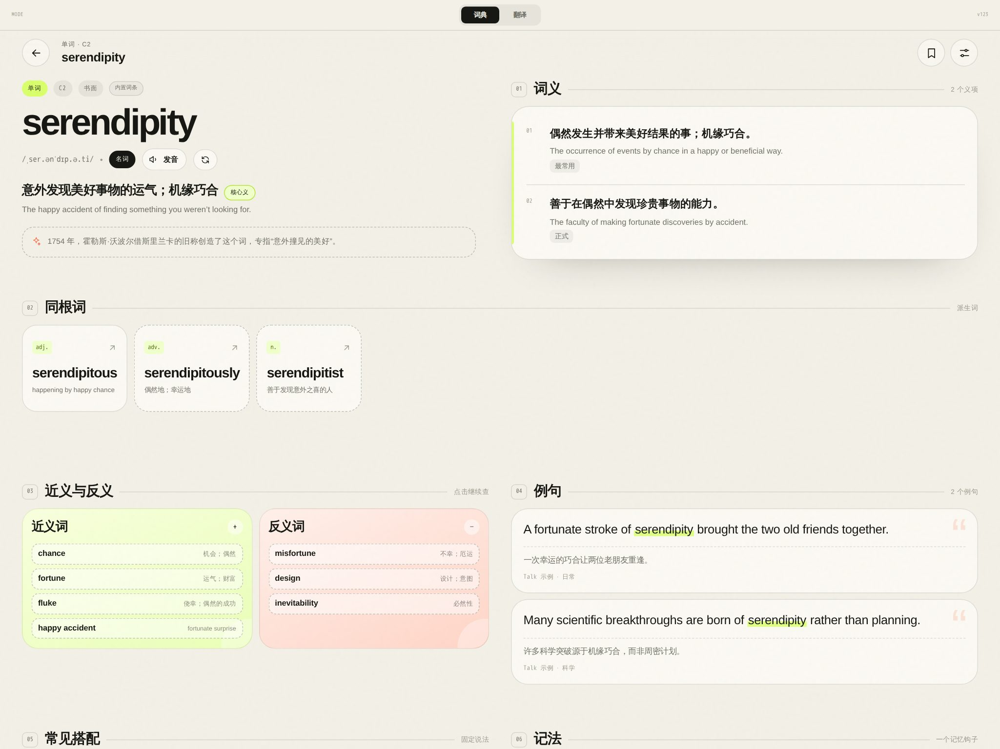
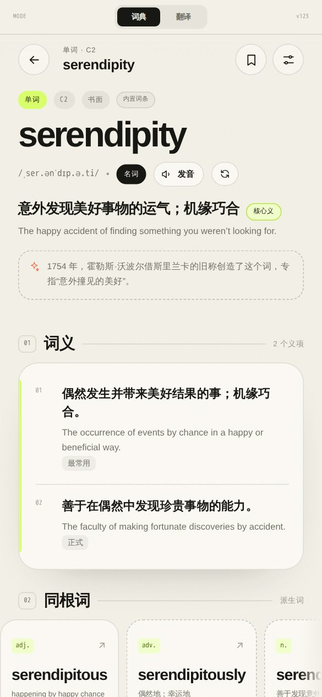
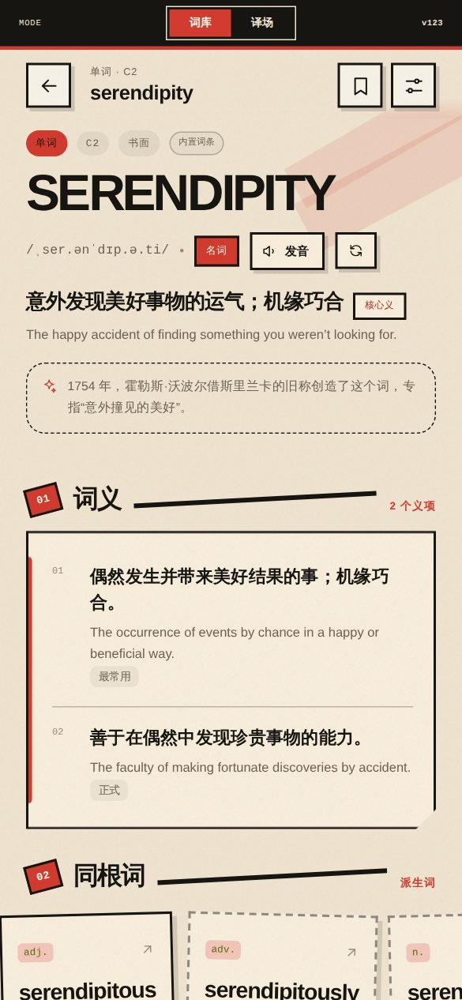
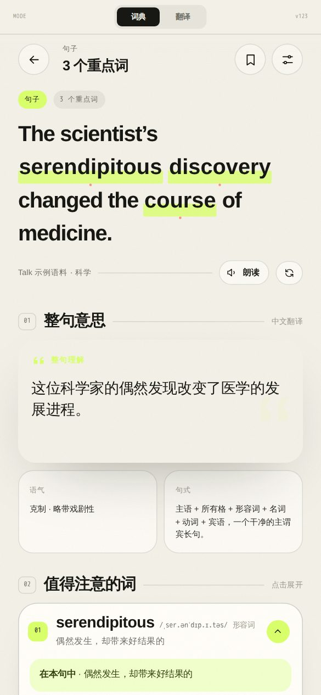
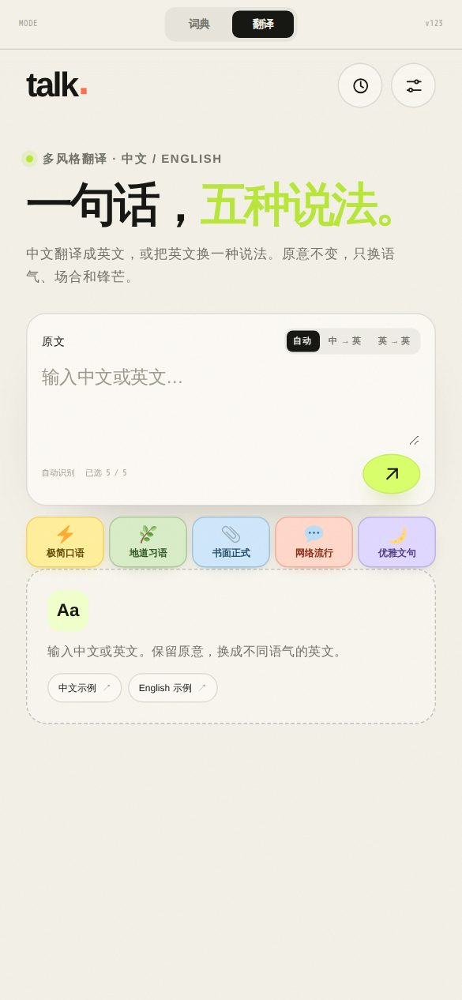
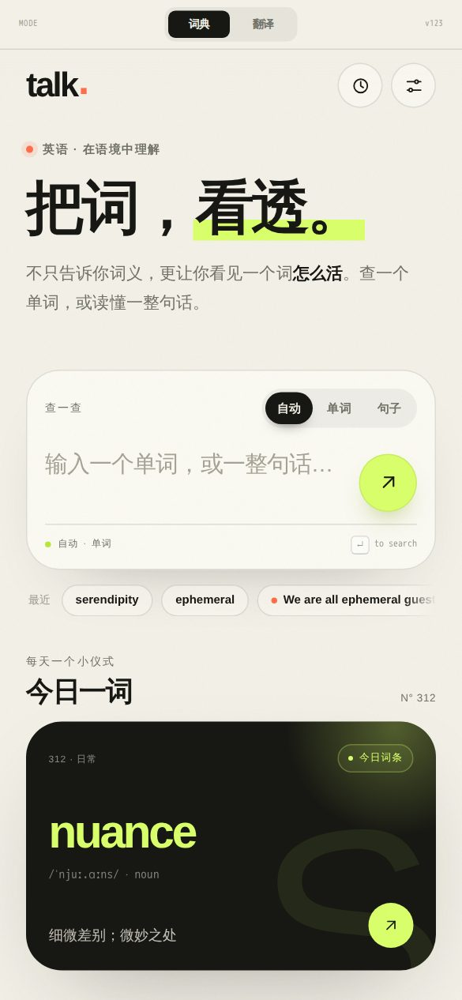
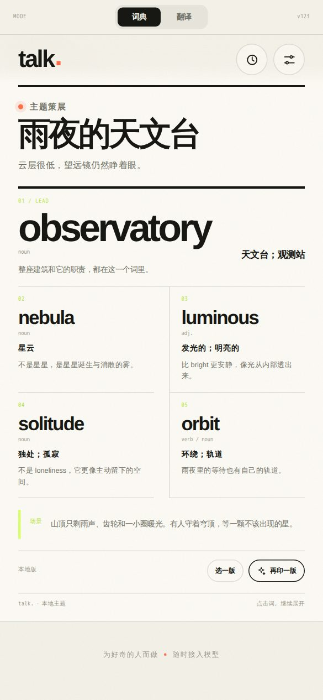
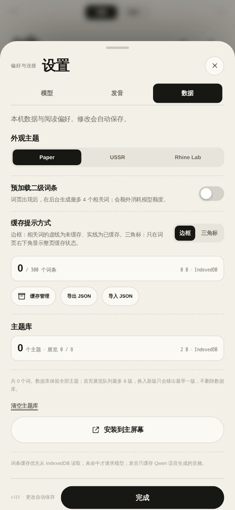

# talk.

<div align="center">

**一本活的英语词典。**

不只告诉你词义，更让你看见一个词怎么活。查一个单词，或读懂一整句话。

[在线体验](https://wundermiku.github.io/talk/) · [实现说明](docs/ARCHITECTURE.md) · [主题开发](THEME.md) · [更新日志](https://github.com/WunderMiku/talk/commits/master)




</div>

## 它是什么

一个纯静态的英汉词典与翻译工具。没有构建步骤，没有后端，没有要下载的模型——整个应用不到 1 MB，浏览器直接和你配置的模型 API 对话。

你可以把它当成：

- **词典**：一个词的音标、义项、词源时间轴、同根词、近反义、搭配、例句、记法，一次给全。
- **阅读器**：贴一整句话进去，它挑出重点词逐个讲，顺带说清语气和句式。
- **改写器**：一句中文，五种语气的英文说法。

数据只存在你自己的浏览器里：查过的词进 IndexedDB，离线也能翻。

## 功能一览

| | |
| --- | --- |
| **查词** | 音标、多词性义项、词源时间轴、同根词、近反义词、常见搭配、例句、记忆法 |
| **句子** | 重点词高亮、整句翻译、语气与句式分析、值得注意的词逐个展开 |
| **翻译** | 极简口语 / 地道习语 / 书面正式 / 网络流行 / 优雅文句，五选多，一次调用 |
| **主题沙龙** | AI 策展：一个场景、五个词，像一期小展览 |
| **三套主题** | Paper、USSR、Rhine Lab，各有自己的语气和版式细节 |
| **离线可用** | PWA 外壳 + 词条缓存，断网也能翻查过的词 |
| **两套发音** | 设备原生语音（默认、离线）或 Qwen 语音（可缓存音频） |
| **八个模型预设** | DeepSeek、OpenAI、Qwen、Kimi、GLM、OpenRouter、Claude、自定义 |

## 查词

一个字进来，一整页出去。上面是词头和词源，下面是分层展开的义项；横屏时自动变成两栏，右栏专门放释义。

 

三档深度（快速 / 标准 / 深入）控制返回多少义项、同根词、例句和搭配。深度只影响**新生成**的词条——已经缓存过的词不会因为你换深度就重新花钱请求。

## 句子

粘贴一句话，标点、大小写、生僻词都不用管。应用会判断这是单词还是句子，走不同的提示词。



重点词用荧光笔标出来，点一下展开讲；整句意思、语气、句式拆开放在下面。

## 翻译

同一句中文，五种说法：极简口语、地道习语、书面正式、网络流行、优雅文句。



风格是可选按钮，只把你选中的风格写进请求——选 2 个就真的少花 3 份 token。支持 `自动 / 中 → 英 / 英 → 英` 三种模式，结果按「源语言 + 原文」缓存 30 天。

## 主题

三套主题不是换配色，是换一整套语气：标题文案、圆角、边框、动效都跟着变。



Paper 是纸感与荧光笔；USSR 是构成主义的红黑斜切；Rhine Lab 是冷调的实验档案。主题在 **设置 → 数据** 里切换，加一套新主题只需要一个 CSS 文件加一条注册表项，见 [THEME.md](THEME.md)。

## 主题沙龙

首页往下翻是一期「主题策展」：一个场景，五个彼此呼应的词，每个词都带着它在这个场景里的意思。



按「再印一版」生成新一期，旧版本留在本地库里随时翻回去。已展出的标题会作为排除列表传给模型，避免重复。

## 缓存与设置

设置分成 **模型 / 发音 / 数据** 三页，改完自动保存。数据页能看到词条库占了多少、清缓存、导出导入 JSON。



词条缓存默认 300 条 / 90 天，可调到 10–2000 条、1–3650 天。缓存命中时不联网，词条页会标出这一条是「缓存」「新生成」还是「内置示例」。

## 快速开始

不需要 Node、不需要打包。任意静态服务器即可：

```bash
bash scripts/fetch-assets.sh .   # 下载一次 vendor/idb.js
python3 -m http.server 8080
```

打开 <http://127.0.0.1:8080/>，进 **设置 → 模型** 填上你自己的 API key 就能用。

> 请用 `127.0.0.1`，不要用局域网 IP：页面带 `upgrade-insecure-requests`，从非 localhost 的 HTTP 地址打开会被浏览器改写成 HTTPS，表现是白屏。

## 配置模型

设置里为每家供应商存一份独立配置：base URL、模型名、API key、显示名。切换配置不会覆盖上一份，可以随时来回换。

- 默认是 DeepSeek 的 `deepseek-chat`；OpenAI 兼容的服务填上 base URL 即可。
- Claude 原生接口不兼容 OpenAI 格式，预设里留空 base URL 并提示改用兼容代理。
- 支持 `reasoning` 开关的模型（`deepseek-v4*`、`glm-5*`、`qwen3.7-flash`、`kimi-k2/k3` 等）会自动显示思考预算输入框。
- Qwen 预设默认关掉思考，否则它会把输出预算耗在推理上，查词变慢。

key 只存在浏览器里（`sessionStorage`，勾选「记住密钥」才落 `localStorage`），从不进仓库。

## 发音

- **系统原生**（默认）：直接用设备的 `speechSynthesis`，零下载、离线可用。
- **Qwen 语音**：用 Qwen 配置里的 key 请求语音合成，默认 `qwen-audio-3.1-tts-plus` + `longanhuan_v3.1`，音频缓存进 IndexedDB，第二次播放不联网。

Qwen 失败时提示原因并自动回退到设备语音，不会让一个词没声音。

## 项目结构

```text
index.html              单页外壳与三处版本号
styles.css              布局与组件，横屏间距收敛为 --word-* 变量
theme.css               基础 token（Paper）
themes/ussr.css         构成主义主题覆盖
themes/rhine.css        Rhine Lab 主题覆盖
theme.js                主题注册表
content.js              基础文案 + 各主题的语气改写
prompts.js              静态模型提示词（与主题无关）
data.js                 内置示例词条
app.js                  应用主体：路由、请求、渲染、缓存、设置
sw.js                   app-shell service worker
vendor/idb.js           构建时下载的 IndexedDB 助手
scripts/screenshots.mjs Playwright 截图脚本
docs/ARCHITECTURE.md    实现说明与设计取舍
```

## 设计上的几个选择

- **静态提示词 + 动态尾巴**：系统提示词整段不变，变的东西（查询词、排除列表）永远放在用户消息末尾，让供应商的前缀缓存一直命中。
- **缓存跨深度复用**：换 fast/standard/deep 不会重新请求，想换版本就点「重新生成词条」——省钱，也避免同样的词反复生成。
- **主题不碰布局**：主题文件只覆盖 token，横屏间距走 `styles.css` 的变量，避免主题之间的 `!important` 打架。
- **流式但不带 `response_format`**：很多网关在「流式 + 结构化输出」同时开启时会缓冲整个响应，所以流式请求靠提示词约束 JSON，普通请求才用 `response_format`。

完整链路、数据结构和缓存表在 [docs/ARCHITECTURE.md](docs/ARCHITECTURE.md)。

## 部署

仓库自带 GitHub Pages 工作流，推上去就发布：

1. **Settings → Pages → Source** 选 **GitHub Actions**
2. 推送到 `main` / `master`，或在 Actions 里手动运行
3. 等部署完成，打开 `https://<user>.github.io/<repo>/`

发布的是纯静态文件，`themes/`、`icons/`、`vendor/idb.js` 都包含在产物里；没有模型要下载，也没有 100 MB 的限制。

## 已知限制

- **没有自动化测试**。改动依赖 [验收清单](docs/ARCHITECTURE.md#手工验收清单) 手测。
- **key 是可见的**。纯前端应用无法隐藏密钥，请用限额 key；要真正藏住只能加代理。
- **局域网 HTTP 预览会白屏**，原因见上文。
- 宽屏下同根词卡片宽度固定，右侧会留白；吸顶栏半透明，滚动时偶尔显得脏。

## 路线图

- 把截图脚本扩成 Playwright 冒烟测试，接进 CI
- 宽屏同根词卡片均分整行
- 吸顶栏滚动时的可读性
- 深度数量在提示词与代码里收敛成单一来源
- 翻译结果的历史与导出

## 许可

[MIT](LICENSE)。

第三方资源各自保留许可：风格图标的 Twemoji SVG 见 [`icons/style/LICENSE.txt`](icons/style/LICENSE.txt)。

---

## English summary

**talk.** is a static, backend-free English–Chinese dictionary and translator that runs entirely in the browser. It renders a word as a living entry — IPA, multiple parts of speech, etymology timeline, word family, synonyms, collocations, examples, mnemonics — and parses whole sentences into key words, tone, and structure. A multi-style translator turns one sentence into five English registers in a single model call.

There is no build step and no bundled model: the site is plain HTML/CSS/JS (< 1 MB) and talks directly to a model API the user configures. Entries are cached in IndexedDB, the app shell is pre-cached by a service worker, and three visual themes (Paper, USSR, Rhine Lab) share one token contract. Model profiles for DeepSeek, OpenAI, Qwen, Kimi, GLM, OpenRouter, and Claude are stored locally; keys never leave the browser.

See [docs/ARCHITECTURE.md](docs/ARCHITECTURE.md) for the request pipeline, prompt structure, cache layout, and deployment details.
