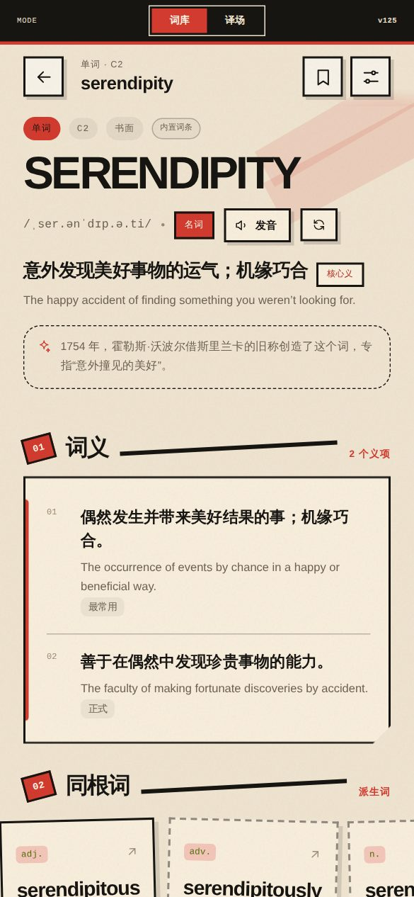
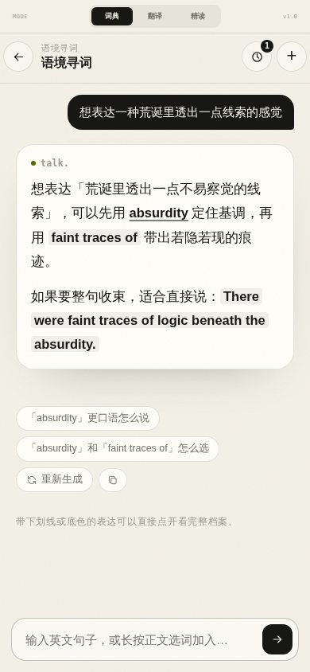
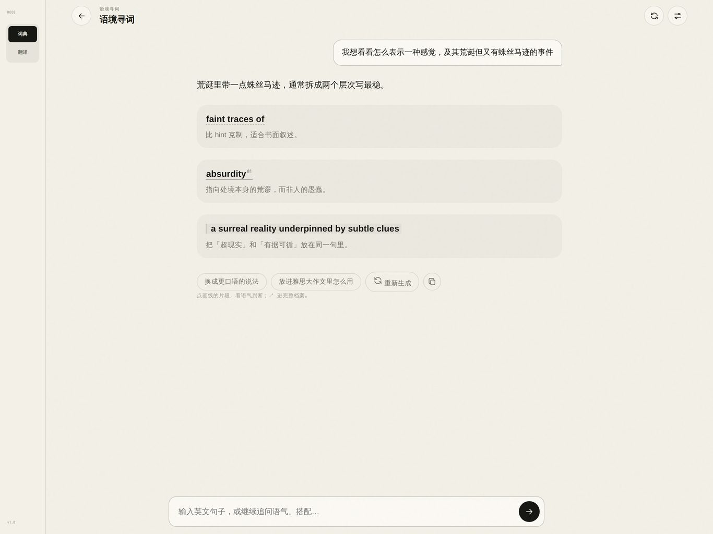
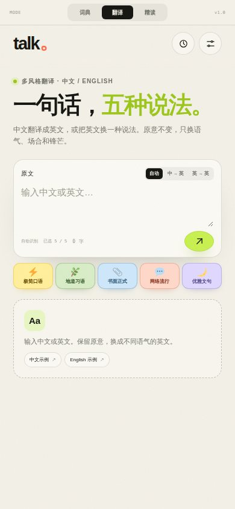
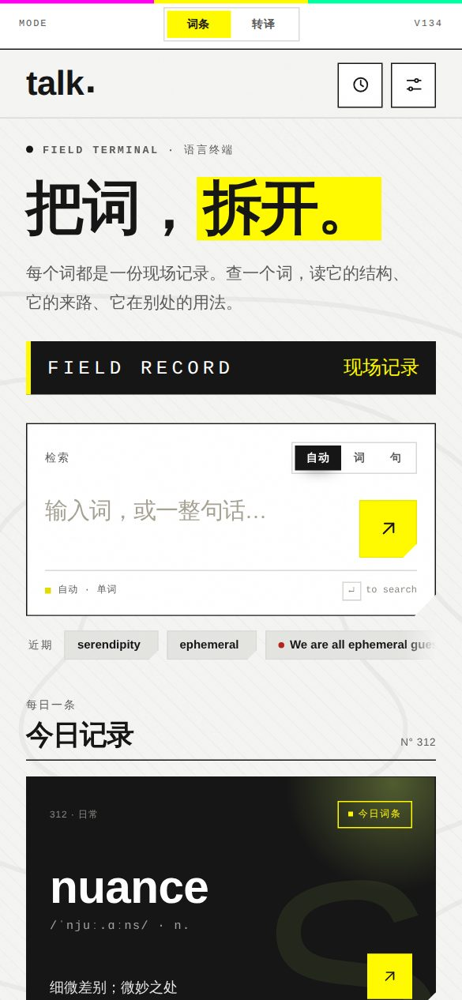
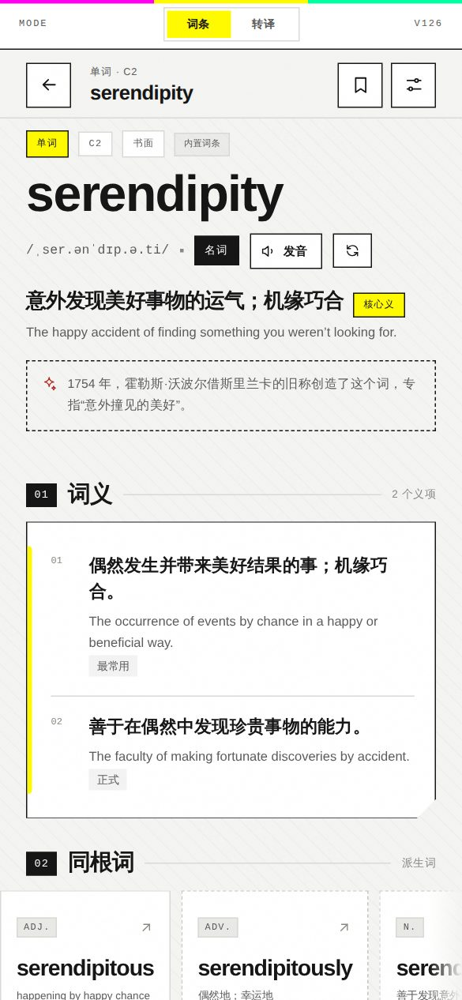
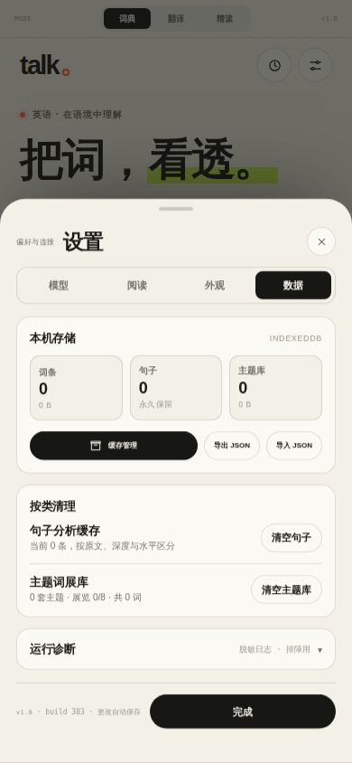

# talk.

<div align="center">

**一本活的英语词典。**

不只告诉你词义，更让你看见一个词怎么活。查一个单词、读懂一整句话，或者描述一个场景，让它替你挑词。

[在线体验](https://wundermiku.github.io/talk/) · [实现说明](docs/ARCHITECTURE.md) · [主题开发](THEME.md) · [更新日志](https://github.com/WunderMiku/talk/commits/master)


</div>

## 它是什么

一个纯静态的英汉词典与翻译工具。没有构建步骤，没有后端，没有要下载的模型——静态资源约 1 MB，浏览器直接和你配置的模型 API 对话。

你可以把它当成：

- **词典**：一个词的音标、义项、词源时间轴、同根词、近反义、搭配、例句、记法，一次给全。
- **阅读器**：贴一整句话进去，它挑出重点词逐个讲，顺带说清语气和句式。
- **改写器**：一句中文，五种语气的英文说法。
- **选词台**：用中文描述你想表达的意思，它给出几个可替换的英文说法，标出语气与适用场景。

数据只存在你自己的浏览器里：查过的词进 IndexedDB，离线也能翻。

## 功能一览

| | |
| --- | --- |
| **查词** | 音标、多词性义项、词源时间轴、同根词、近反义词、常见搭配、例句、记忆法 |
| **句子** | 三视角（原句 / 意群 / 焦点）、从句洋葱折叠、逐句翻译与结构、按考试等级控制重点词 |
| **语境寻词** | 描述场景，得到 3–5 个行内标注的英文说法；点开看语气与判断，可继续追问 |
| **翻译** | 极简口语 / 地道习语 / 书面正式 / 网络流行 / 优雅文句，五选多，一次调用 |
| **主题沙龙** | AI 策展：一个场景、五个词，像一期小展览 |
| **六套主题** | Paper、USSR、Rhine Lab、Endfield、Rhine Lab · Access、Bitterworld，各有自己的语气和版式细节 |
| **离线可用** | PWA 外壳 + 词条缓存，断网也能翻查过的词 |
| **两套发音** | 设备原生语音（默认、离线）或 Qwen 语音（可缓存音频） |
| **模型模板** | 从供应商模板新建自己的配置，支持获取模型列表与连通性测试 |

## 查词

一个字进来，一整页出去。上面是词头和词源，下面是分层展开的义项；横屏时自动变成两栏，右栏专门放释义，加载骨架也照同样的两栏排布，词典 / 翻译的切换则收进左侧竖条。

 

三档深度（快速 / 标准 / 深入）控制返回多少义项、同根词、例句和搭配。深度只影响**新生成**的词条——已经缓存过的词不会因为你换深度就重新花钱请求。

## 句子

粘贴一句或一整段，标点、大小写、生僻词都不用管。应用会自动分句，逐句分析，再把整段的主旨拼回来。


- **三视角**：原句 / 意群切分 / 信息焦点，切换看同一句话的不同读法。
- **洋葱折叠**：从句默认折成行内的小 `+`，点开就地展开；可以逐层开，也可以一键全部展开或收回主干。设置里能选「缩进块」或「句内插入」两种展开方式。
- **逐句独立**：多句输入时每句有自己的译文、结构树、例句和重点词，不会把后一句折进前一句。
- **按等级取词**：在设置里选中考 / 高考 / CET-4 / CET-6 / 考研 / 雅思 / 托福，重点词的数量与讲解深度跟着变。

整段译文与主旨放在最上面，下面按「句子 1、句子 2…」分段；每句的重点词还能标出它在段落里的位置。

## 语境寻词

用中文描述你想表达什么——「一种荒诞但又有蛛丝马迹的感觉」——它会用一段话说明怎么拆，并把 3–5 个可用的英文片段直接标在正文里。

 

- **三种标注**：实线下划线是词，虚线是搭配，左侧细竖条是整句；句子主体单独成行，中文解释小一号跟在下面。
- **点开判断**：任意标注都会在输入框上方拉起一张停靠卡，显示语气徽章和一句判断，不与正文重叠。
- **继续追问**：底部的输入坞可以接着问，模型会带上这一页里之前的问答作为上下文；推荐追问由模型现场生成。
- **进完整词条**：卡片右侧的 ↗ 会带着当前词跳到词条页，返回时回到原来的位置。

## 翻译

同一句中文，五种说法：极简口语、地道习语、书面正式、网络流行、优雅文句。



风格是可选按钮，只把你选中的风格写进请求——选 2 个就真的少花 3 份 token。支持 `自动 / 中 → 英 / 英 → 英` 三种模式，结果按「源语言 + 原文」缓存 30 天。

## 主题

六套主题不是换配色，是换一整套语气：标题文案、圆角、边框、动效都跟着变。

 

- **Paper**：纸感与荧光笔，默认主题，字距最松。
- **USSR**：构成主义的红黑斜切，标题像海报。
- **Rhine Lab**：冷调的实验档案，细线、刻度与编号。
- **Endfield**：工业终端的现场记录。纸白底、切角面板、编号区块，全站只有一种信号黄，只用来点「当前」。
- **Rhine Lab · Access**：实验记录终端，纸白、细线窗口与唯一一种酸性绿。
- **Bitterworld**：票根拼贴，米纸、墨线、检票章与一条虚线路线。



主题在 **设置 → 数据** 里切换，加一套新主题只需要一个 CSS 文件加一条注册表项，见 [THEME.md](THEME.md)。

## 主题沙龙

首页往下翻是一期「主题策展」：一个场景，五个彼此呼应的词，每个词都带着它在这个场景里的意思。


按「再印一版」生成新一期，旧版本留在本地库里随时翻回去。已展出的标题会作为排除列表传给模型，避免重复。

## 缓存与设置

设置分成 **模型 / 发音 / 数据** 三页，改完自动保存。数据页能看到词条库占了多少、清缓存、导出导入 JSON。



词条缓存默认 300 条 / 90 天，可调到 10–2000 条、1–3650 天。缓存命中时不联网，词条页会标出这一条是「缓存」「新生成」还是「内置示例」。

## 快速开始

不需要 Node、不需要打包，`vendor/` 依赖已随仓库提交。任意静态服务器即可：

```bash
python3 -m http.server 8080
```

打开 <http://127.0.0.1:8080/>，进 **设置 → 模型** 填上你自己的 API key 就能用。

> 局域网 IP 的 HTTP 地址也能直接打开。但非安全上下文（非 localhost 的 HTTP）没有 `crypto.subtle`，密钥加密封存与 service worker 不可用；要在手机上完整体验请用 HTTPS。
>
> 可选：`bash scripts/fetch-assets.sh .` 重新下载 vendor 依赖（仅升级版本时需要，下载带 SHA-256 校验）。

## 配置模型

设置 → 模型 里维护的是**你自己的配置列表**，不是一个写死的供应商清单：

1. 点「+ 添加模型」，选一个供应商模板（DeepSeek、OpenAI、Google Gemini、Qwen、Kimi、GLM、OpenRouter、Claude、自定义）。
2. 模板会预填协议、Base URL 和常用模型；按需改地址、填 API key。
3. 「获取模型」会请求该服务的模型列表（OpenAI 的 `/models`、Gemini 的 `/v1beta/models`），点一下就能选中；也可以手填。
4. 「测试当前模型」发一个 16 token 的最小请求，回报耗时，确认地址与密钥能通。
5. 保存后列表里只留下你建过的配置；点一行切换当前模型，右侧「编辑」再改。

- 协议目前支持 **OpenAI 兼容** 与 **Google Gemini** 两种；Claude 原生接口不是 OpenAI 格式，需要在模板里填一个兼容代理地址。
- 编辑时 API key 留空表示沿用原来的密钥，不会因为改模型名而丢 key。

密钥加密后存在本机：用 AES-GCM 封成密文再写 `sessionStorage`（勾选「记住密钥」才写 `localStorage`），解封用的密钥是不可导出的 `CryptoKey`，存在 IndexedDB 里读不出来。它能挡住翻存储、翻备份，但挡不住能在本页执行脚本的人——纯前端从原理上藏不住 key，要真隔离只能用代理。详见 [实现说明](docs/ARCHITECTURE.md#api-密钥怎么存)。

## 发音

- **系统原生**（默认）：直接用设备的 `speechSynthesis`，零下载、离线可用。
- **Qwen 语音**：用 Qwen 配置里的 key 请求语音合成，默认 `qwen-audio-3.1-tts-plus` + `longanhuan_v3.1`，音频缓存进 IndexedDB，第二次播放不联网。

Qwen 失败时提示原因并自动回退到设备语音，不会让一个词没声音。

## 项目结构

```text
index.html              单页外壳、资源版本参数与构建号
css/styles.css          布局与组件，横屏间距收敛为 --word-* 变量
css/theme.css           基础 token（Paper）
css/themes/ussr.css     构成主义主题覆盖
css/themes/rhine.css    Rhine Lab 主题覆盖
css/themes/endfield.css Endfield 主题覆盖
css/themes/rhineaccess.css  Rhine Lab · Access 主题覆盖
css/themes/bitterworld.css  未许之地主题覆盖
js/theme.js             主题注册表
js/content.js           基础文案 + 各主题的语气改写
js/prompts.js           静态模型提示词（与主题无关）
js/data.js              内置示例词条
js/app.js               应用主体：路由、请求、渲染、缓存、设置
sw.js                   app-shell service worker
vendor/                 随仓库提交的运行依赖（idb、Lenis、html-to-image）
scripts/screenshots.mjs Playwright 截图脚本
scripts/dev/            一次性调试与审查脚本（从仓库根运行）
tests/                  离线端到端测试（假模型 + Playwright）
docs/ARCHITECTURE.md    实现说明与设计取舍
docs/TESTING.md         测试怎么跑、怎么加
```

## 开发与测试

站点没有构建步骤；`package.json` 只为测试与截图脚本存在。

```bash
npm install
npx playwright install chromium
npm test
```

测试不需要 API key：页面会被指向同源的假模型（`/__mock`），用例与桩数据都在 `tests/`。单独跑某个套件用 `npm test -- chunk`，看用例列表用 `npm test -- --list`。

## 设计上的几个选择

- **静态提示词 + 动态尾巴**：系统提示词整段不变，变的东西（查询词、排除列表）永远放在用户消息末尾，让供应商的前缀缓存一直命中。
- **缓存跨深度复用**：换 fast/standard/deep 不会重新请求，想换版本就点「重新生成词条」——省钱，也避免同样的词反复生成。
- **主题不碰布局**：主题文件只覆盖 token，横屏间距走 `css/styles.css` 的变量，避免主题之间的 `!important` 打架。
- **流式但不带 `response_format`**：很多网关在「流式 + 结构化输出」同时开启时会缓冲整个响应，所以流式请求靠提示词约束 JSON，普通请求才用 `response_format`。

完整链路、数据结构和缓存表在 [docs/ARCHITECTURE.md](docs/ARCHITECTURE.md)。

## 部署

仓库自带 GitHub Pages 工作流，推上去就发布：

1. **Settings → Pages → Source** 选 **GitHub Actions**
2. 推送到 `main` / `master`，或在 Actions 里手动运行
3. 等部署完成，打开 `https://<user>.github.io/<repo>/`

发布的是纯静态文件，`css/`、`js/`、`icons/`、`vendor/` 都包含在产物里；没有模型要下载，也没有 100 MB 的限制。

## 已知限制

- **key 是加密存储、而非真正保密**。密文挡得住翻看，挡不住同源脚本；请用限额 key，要真正隔离只能加代理。
- **局域网 HTTP 下密钥无法加密**。非安全上下文没有 `crypto.subtle`，密钥加密封存与 service worker 不可用，完整功能请走 HTTPS 或 localhost。
- 宽屏下同根词卡片宽度固定，右侧会留白。
- 语境寻词的多轮上下文只保留在当前页面里，刷新后能恢复最后一轮，但更早的追问记录不会跨刷新保存。

## 路线图

- 给 GitHub Actions 加测试 job，让推送前自动跑一遍端到端
- 语境寻词的多轮记录持久化，刷新后仍能接着追问
- 宽屏下同根词卡片均分整行
- 翻译结果的历史与导出

## 许可

[MIT](LICENSE)。

第三方资源各自保留许可：风格图标的 Twemoji SVG 见 [`icons/style/LICENSE.txt`](icons/style/LICENSE.txt)。

---

## English summary

**talk.** is a static, backend-free English–Chinese dictionary and translator that runs entirely in the browser. It renders a word as a living entry — IPA, multiple parts of speech, etymology timeline, word family, synonyms, collocations, examples, mnemonics — parses whole sentences into key words, tone, and structure, and turns a described scene into a short list of annotated English expressions with a tone verdict for each. A multi-style translator turns one sentence into five English registers in a single model call.

There is no build step and no bundled model: the site is plain HTML/CSS/JS (about 1 MB) and talks directly to a model API the user configures. Entries are cached in IndexedDB, the app shell is pre-cached by a service worker, and six visual themes (Paper, USSR, Rhine Lab, Endfield, Rhine Lab · Access, Bitterworld) share one token contract. Model channels are created from provider templates, fetched model lists, and a connectivity test; they are stored locally, with API keys sealed by AES-GCM (non-extractable key in IndexedDB) before they touch storage; nothing leaves the browser.

See [docs/ARCHITECTURE.md](docs/ARCHITECTURE.md) for the request pipeline, prompt structure, cache layout, and deployment details.
