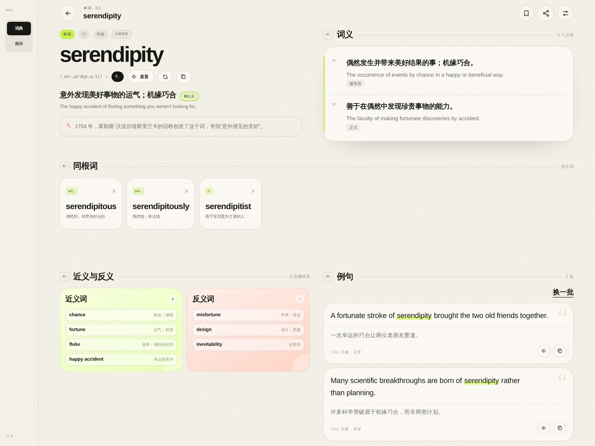
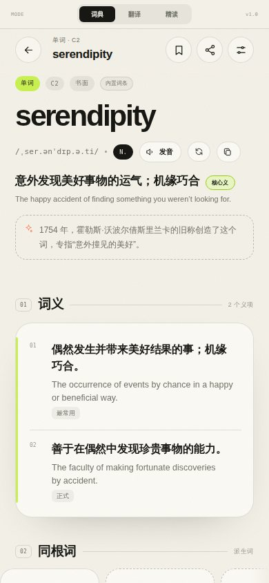
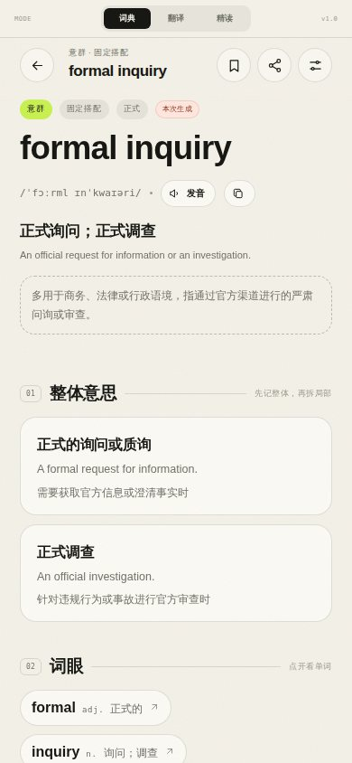
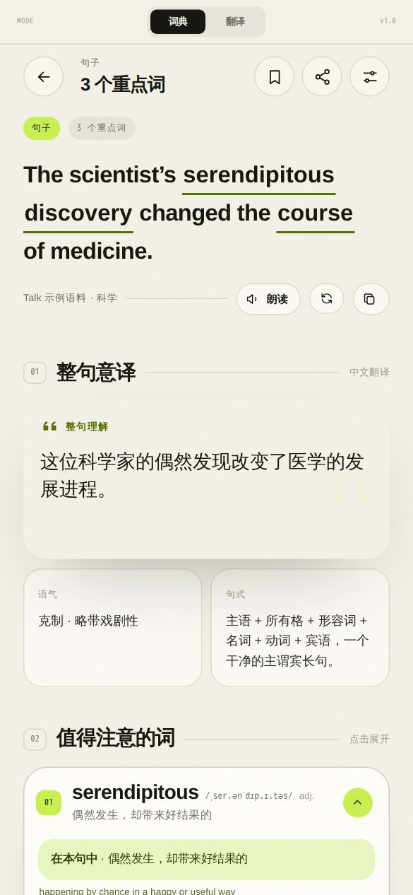
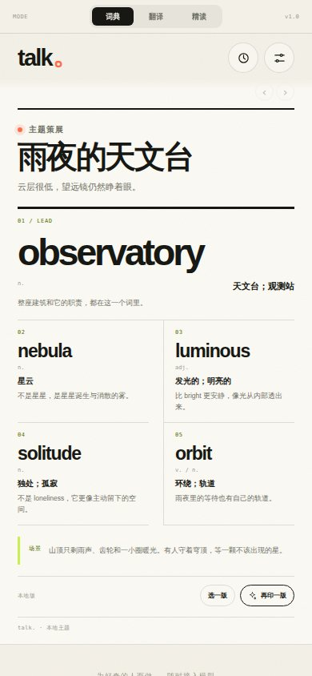
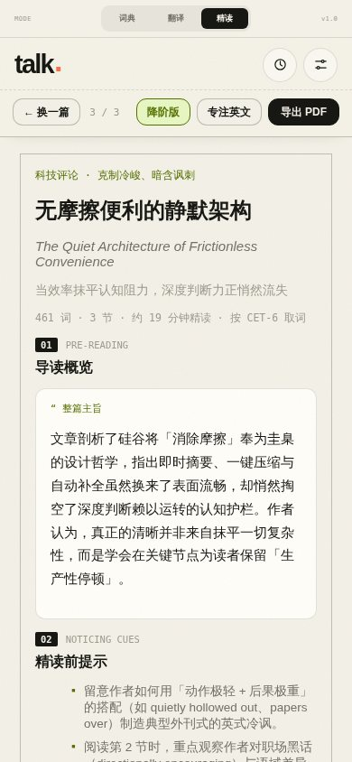
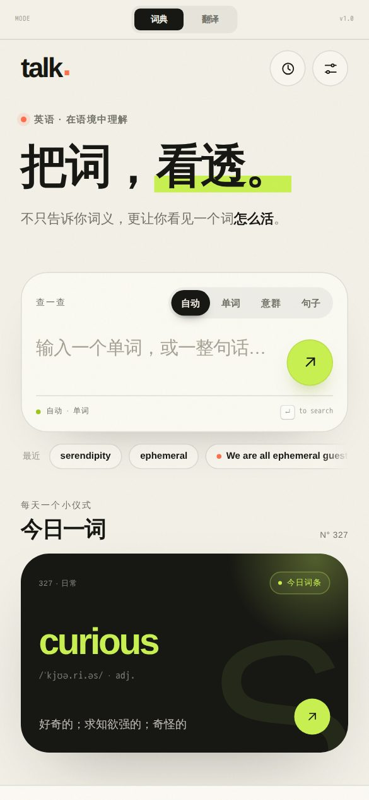
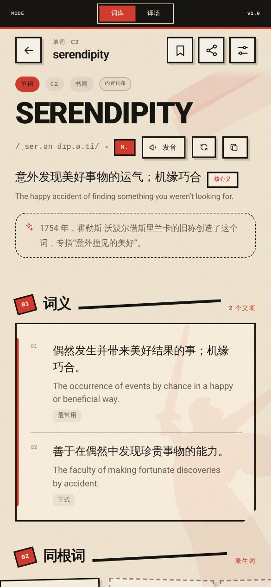
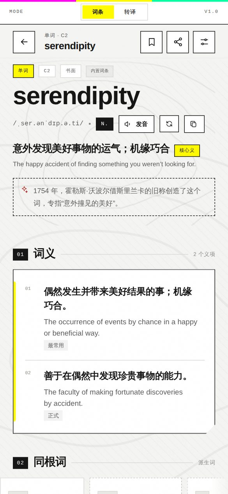
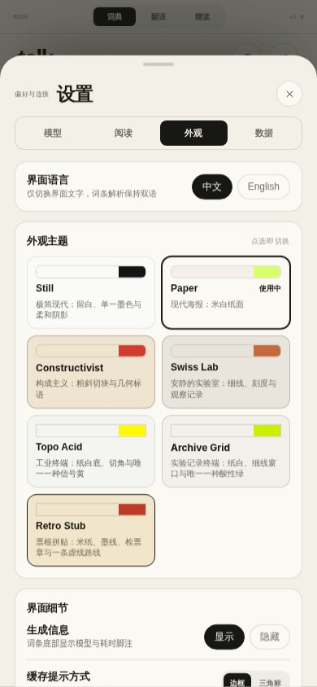

# talk.

<div align="center">

**一本活的英语词典、多风格翻译台与外刊精读本。**

不只告诉你词义，更让你看见一个词在真实语境里怎么活。  
查单词、拆意群、读长句、语境寻词、多风格翻译、长文精读——全都在一个无构建、无后端的纯静态应用里完成。

[在线体验](https://wundermiku.github.io/talk/) · [下载 Android APK](https://github.com/WunderMiku/talk/releases) · [实现说明](docs/ARCHITECTURE.md) · [主题开发](THEME.md) · [更新日志](https://github.com/WunderMiku/talk/commits/master)


<br>



</div>

---

## 核心特性

`talk.` 是一个纯前端静态应用（原生 HTML / CSS / ESM JS），**没有构建步骤、没有服务端代理、没有内置大模型权重**。静态外壳不足 1 MB，浏览器直连你自己配置的模型接口，所有学习记录、词条缓存、精读文章与生词书库全部保存在本机 IndexedDB 中，断网也能离线查阅。

| 模块 | 能力一览 |
| :--- | :--- |
| **词典 · 单词** | 音标、多词性分栏义项、词源时间轴、同根词、近反义词、常见搭配、主题例句、记忆法；点任意关联词直接叠出**二级词层抽屉**深挖 |
| **词典 · 意群** | 自动识别固定搭配 / 短语动词 / 习语，先讲整体意思与使用场景，再拆出可点击的**词眼**与替换例句 |
| **词典 · 句子** | **三视角可视化阅读**（原句 / 意群切分 / 信息焦点）、编号信息推进流、语气与句式拆解、按考试阶段（中考 → 托福）动态标出重点词 |
| **词典 · 语境寻词** | 用中文描述想表达的感觉或场景，AI 给出带行内下划线标注的 3–5 个英文表达，点开看语气判断并支持**多轮追问（刷新不丢上下文）** |
| **多风格翻译** | 一句话一次生成最多 5 种语气（极简口语 / 地道习语 / 书面正式 / 网络流行 / 优雅文句），按需勾选省 token，支持自动 / 中→英 / 英→英 |
| **长文精读本** | 粘贴或导入英文长文 / Markdown，自动生成全文导读、精读前提示、逐段精读与降阶版对照；行内点词底部速查、一键收藏、**导出可装订 PDF** |
| **词汇书库** | 历史与收藏统一收进时钟抽屉，内置「密集书库」与自定义分册，支持 **AI 自动归类（零丢失审计）** 以及 `.txt` / CSV / JSON 导入导出 |
| **主题沙龙 & 分享图** | 首页每日一词 + AI 策展「主题词展」；任意词条、意群、句子一键合成为 1080px 宽的杂志风分享长图 |
| **七套完整主题** | Paper、Still、Constructivist、Swiss Lab、Topo Acid、Archive Grid、Retro Stub，支持一键切换与中 / 英双语界面 |
| **三大原生模型协议** | 原生支持 **OpenAI 兼容**、**Anthropic (Claude Messages API)**、**Google Gemini**，支持拉取模型列表、扩展思考配置与一键连通测试 |
| **多端与离线** | PWA 离线可用 + Capacitor 打包 **Android 原生 APK**（原生返回键、状态栏与手势适配）；全量 IndexedDB 永久缓存，支持 JSON 备份恢复 |

---

## 三大工作区

### 1. 词典：单词 · 意群 · 句子 · 语境寻词

顶部输入栏自动判断你输入的是单词、固定搭配、英文长句还是中文描述（也可以手动指定模式）：

<p align="center">
  
  
  
</p>

- **单词页**：三档生成深度（快速 / 标准 / 深入）控制释义与搭配详略，仅作用于新生成词条，已缓存词条不会重复花钱请求；点击任意同根词、近反义词或例句高亮词，会自底向上叠开**多层词义抽屉**，探索完逐层返回原位。
- **意群页**：针对 `formal inquiry`、`take off`、`by the way` 这类多词表达，先交代整体语义、语体与适用场景，再把核心词眼拆出来供继续点击深入。
- **句子页**：支持单句与多句段落，在 **原句 / 意群切分 / 信息焦点** 三个视角之间无跳动切换，配合下方编号「信息推进」看清句子的主干与节奏；按你在设置里选定的学习阶段（中考 / 高考 / CET-4 / CET-6 / 考研 / 雅思 / 托福）动态调整重点词深度。
- **语境寻词**：直接用中文描述你想说的话（如「一种荒诞里透出一点线索的感觉」），AI 用自然段落讲解并用 `[[...]]` 行内标注出可替换表达；底部支持持续追问，整条对话链保存在本地 IndexedDB，刷新后完整恢复。

<p align="center">
  
  
</p>

---

### 2. 翻译：五种语气的平行表达

同一句话，在一次模型请求里并行产出多种语域：**极简口语 · 地道习语 · 书面正式 · 网络流行 · 优雅文句**。

- 风格按钮可自由多选，未勾选的风格不会写进提示词，实打实省 token。
- 支持 `自动 / 中 → 英 / 英 → 英` 三种方向，结果自动缓存在本地 IndexedDB。

<p align="center">
  
</p>

---

### 3. 精读：长文导读、双版对照与 PDF 打印本

切换到顶部 **精读** 模式，粘贴英文文章或导入 Markdown / 纯文本，把一篇外刊变成一份可交互的精读小册子（内置免 API Key 的离线示例文章可直接体验）：

- **结构化导读**：自动提炼整篇主旨、精读前观察提示（Noticing Cues）与分节脉络。
- **双模式阅读**：支持原文 / 降阶版切换与「专注英文」模糊遮罩（点击单段揭示中文释义）。
- **行内速查与书库联动**：点击文中任意英文词，底部 Dock 即刻弹出结合当前上下文的速查释义，一键收入生词书库。
- **实体打印友好**：支持导出排版考究的 PDF 精读本，并可开启**左侧装订边距**方便打印装订。

<p align="center">
  
</p>

---

## 七套主题与四分类设置

七套主题不只是换颜色，还自带独立的文案语气、边框几何、字重比例与排版性格：

| 主题 | 视觉性格 |
| :--- | :--- |
| **Paper**（默认） | 现代海报：温润米白纸面与荧光黄绿点缀 |
| **Still** | 极简现代：克制留白、单一墨色与柔和阴影 |
| **Constructivist** | 构成主义：红黑粗斜切块与海报标语 |
| **Swiss Lab** | 安静的实验室：细线网格、刻度与观察记录 |
| **Topo Acid** | 工业终端：纸白切角面板与唯一信号黄 |
| **Archive Grid** | 实验记录终端：细线窗口与酸性绿高亮 |
| **Retro Stub** | 票根拼贴：米纸、墨线、检票章与虚线路线 |

<p align="center">
  
  
  
</p>

设置面板按使用心智分为 **模型 / 阅读 / 外观 / 数据** 四页，所有修改自动保存：

- **模型**：多渠道列表（显示协议标签与主机）、一键连通测试、深度思考开关与预算、本机加密记住密钥。
- **阅读**：生成深度、学习阶段、语境寻词输出上限滑块、朗读发音（系统原生 / Qwen 语音与试听），以及折叠收纳的高级选项（二级词条预加载、各主题例句风格）。
- **外观**：中 / 英界面语言切换、双列双色预览卡**点一下即切主题**、生成脚注与缓存提示样式。
- **数据**：词条 / 句子 / 主题库三项存储总览、缓存管理明细页、JSON 导入导出备份、按类清理，以及折叠收纳的脱敏运行诊断日志。

<p align="center">
  
  
</p>

---

## 快速开始

### 本地运行（零构建）

仓库已包含 `vendor/` 运行依赖，不需要 Node 打包，任意静态文件服务器即可启动：

```bash
python3 -m http.server 8080
```

浏览器打开 <http://127.0.0.1:8080/>，进入 **设置 → 模型** 添加一个模型渠道即可开始使用。未配置模型时也能完整体验内置词条、主题切换与离线精读示例。

> 局域网非 `localhost` 的 HTTP 地址缺少浏览器安全上下文（`crypto.subtle` 与 Service Worker 不可用）；手机浏览器或正式使用建议走 HTTPS，或直接安装 Android APK。

### 模型协议与接入

在 **设置 → 模型 → + 添加模型** 中，可从模板（DeepSeek、OpenAI、Anthropic Claude、Google Gemini、Qwen、Kimi、GLM、OpenRouter、自定义）快速创建并管理多套渠道配置：

| 协议 | 原生端点与特性 |
| :--- | :--- |
| **OpenAI 兼容** | `/chat/completions` + `/models`，流式 SSE、推理字段识别、不兼容网关自动降级重试 |
| **Anthropic (Claude)** | 原生 `/v1/messages` + `/v1/models`，自动附带 `x-api-key`、`anthropic-version`、`anthropic-dangerous-direct-browser-access` 请求头，支持扩展思考（`thinking`）与原生 SSE 流 |
| **Google Gemini** | 原生 `/v1beta/models/...:streamGenerateContent` 与模型发现接口，支持 `thinkingBudget` |

- **密钥存储**：默认仅在当前会话生效，勾选「在这台设备上记住密钥」后经 Web Crypto API（AES-GCM + IndexedDB 内不可导出的 `CryptoKey`）封存到本机存储。纯前端无法隔离同源脚本，建议配合带额度上限的 API Key 或自建代理使用。
- **朗读发音**：默认使用系统原生 `speechSynthesis`（离线零费用）；也可在 **设置 → 阅读** 切换为 **Qwen 语音**（自动复用 Qwen 渠道密钥，合成音频缓存进 IndexedDB，失败自动回退原生语音）。

---

## Android APK 与部署

### GitHub Pages 自动发布

仓库自带 [`.github/workflows/pages.yml`](.github/workflows/pages.yml)，推送到 `master` / `main` 即通过 `scripts/build-web.mjs` 组装纯静态产物并自动发布到 GitHub Pages。

### Android 原生包（Capacitor）

- **自动构建**：仓库内置 [`.github/workflows/android-apk.yml`](.github/workflows/android-apk.yml)，可直接在 GitHub Actions 构建并发布 Android APK（在 [Releases](https://github.com/WunderMiku/talk/releases) 下载）。
- **本地准备**：
  ```bash
  npm install
  npm run android:prepare   # 组装 dist/、初始化 Capacitor Android 工程并注入原生适配
  npm run android:sync      # 前端改动后同步到 Android 工程
  ```

---

## 项目结构

```text
index.html                单页入口、静态资源版本参数与构建号
css/theme.css             基础设计 token（Paper）
css/styles.css            核心布局、排版 token（--lh-display*）、组件与响应式规则
css/print-reader.css      长文精读本与 PDF 打印装订样式
css/themes/               其余六套主题覆盖（still / constructivist / swiss-lab / topo-acid / archive-grid / retro-stub）
js/llm-client.js          统一模型传输层（OpenAI / Anthropic Claude / Gemini 流式、重试与探测）
js/app.js                 应用入口：依赖装配、路由、动效与 __TALK_BRIDGE__
js/content.js             基础文案与各主题语气改写
js/prompts.js             静态系统提示词（最大化供应商前缀缓存命中）
js/data.js                内置离线示例词条
js/theme.js               七套主题注册表
js/i18n.js                中 / 英界面语言映射
js/wordbooks.js           词汇书库引擎（多书库、AI 零丢失分册、导入导出）
js/doc-parser.js          长文精读解析器（Markdown / 纯文本）
js/doc-reader.js          长文精读本视图、行内速查 Dock 与 PDF 导出
js/native-bridge.js       Capacitor Android 原生返回键、状态栏与恢复重绘桥接
js/core/                  通用工具、图标、脱敏诊断日志与 data-action 分发器
js/storage/               AES-GCM 密钥封存、设置/历史、通用 IndexedDB KV 与词条/句子缓存
js/model/                 流式 JSON 预览、行内锚点、数据归一化与查询编排
js/features/              朗读（原生 / Qwen）、主题词展沙龙与 1080px 分享图合成
js/views/                 首页、单词/意群/句子/寻词/翻译视图、多层抽屉栈、历史书库与四页签设置
sw.js                     PWA App-Shell Service Worker（自动预缓存全部 ESM 子模块）
vendor/                   随仓库提交的运行依赖（idb、Lenis、html-to-image）
scripts/                  build-web.mjs / bump-build.mjs / setup-android-native.mjs / screenshots.mjs
tests/                    单元测试 + Playwright 离线端到端测试套件（内置本地 Mock 模型服务）
docs/ARCHITECTURE.md      架构细节、提示词设计与存储表说明
docs/TESTING.md           测试运行与编写指南
```

---

## 开发与测试

站点本身零构建；`package.json` 仅用于离线测试、构建号同步与 Android 打包：

```bash
npm install
npx playwright install chromium

npm test               # 运行全部单元测试 + Playwright 离线端到端测试
npm test -- sentence   # 仅运行匹配名称的测试套件
npm run test:list      # 列出全部测试套件与用例
npm run check:shell    # 校验构建号同步、SW 预缓存清单完整性与 JS 语法
npm run bump           # 递增构建号并自动同步 index.html / sw.js / js/app.js
```

所有端到端测试均直连内置同源 Mock 服务（`/__mock`），无需真实 API Key。仓库同时配置了 [`.github/workflows/test.yml`](.github/workflows/test.yml) 持续运行自动化回归。

---

## 许可

[MIT](LICENSE)。风格图标使用的 Twemoji SVG 许可见 [`icons/style/LICENSE.txt`](icons/style/LICENSE.txt)。

---

## English Summary

**talk.** is a zero-build, backend-free English–Chinese AI dictionary, multi-style translator, and intensive reading booklet that runs as both a static PWA and a Capacitor Android app.

- **Three integrated workspaces**: **Dictionary** (living word entries with layered drill-down drawers, collocation/chunk breakdowns, 3-view sentence segmentation, and multi-turn context word search), **Translator** (up to 5 English registers in one call), and **Reader** (long-form English articles with overview, noticing cues, inline contextual lookup dock, wordbook sync, and printable PDF export).
- **Native multi-protocol LLM client**: speaks **OpenAI-compatible**, **Anthropic (Claude Messages API)**, and **Google Gemini** natively from the browser, with model discovery, extended thinking controls, connectivity tests, and AES-GCM sealed local key storage.
- **Local-first & themeable**: unlimited IndexedDB persistence for words, chunks, sentences, reverse threads, translations, wordbooks, reader booklets, and cached TTS audio; 7 full design themes with one-tap switching and Chinese/English UI.

See [docs/ARCHITECTURE.md](docs/ARCHITECTURE.md) for implementation details and [docs/TESTING.md](docs/TESTING.md) for the offline test suite.
